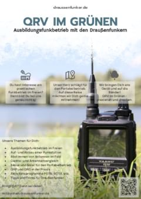
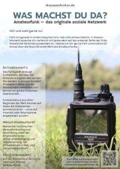

# Auch Bock? Jetzt Draußenfunker werden!

Unsere Community ist in unserem Forum auf [Discord](https://discord.gg/4RkRRwXtty) aktiv und tauscht sich dort über die gemeinsamen Funk-Treffen, die neusten Selbstbauprojekte und viele weitere Themen aus. Neueinsteiger finden bei uns Unterstützung bei der Prüfungsvorbereitung oder allgemein zum Thema Amateurfunk. Du hast Interesse am Thema Amateurfunk und insbesondere am Funken im Grünen? Dann klick den Link und sag Hallo!

[Jetzt mitmachen: zu unserem Discord-Server](https://discord.gg/4RkRRwXtty)

## Für Funkamateure

Wir bieten regelmäßig Aktionen zum Reinschnuppern, Mitmachen und Weitererzählen an. Neben den Informationen auf dieser Website und auf unserem Discord-Server haben wir auch einen [Flyer](/images/mitmachen/Draussenfunker_Flyer_Mitmachen.pdf) zum Weitergeben - zum Beispiel beim OV-Abend. Für alle Nicht-Funkamateure: das sind die Treffen der lokalen Gruppen des [Deutschen Amateur-Radio-Club (DARC) e.V.](https://www.darc.de/home). Ihr habt Interesse, gemeinsam mit uns Portabelbetrieb zu machen? Meldet euch! Wir freuen uns auf die gemeinsame Zeit on air.

::: tip QRV via Brandmeister, YSF und FM-Funknetz
Für den direkten Austausch haben wir auch einen YSF-Reflector, der mit dem Brandmeister-DMR-Netz gekoppelt ist. Der Draussenfunker-Reflector ist im YSF-Netz (C4FM) über die ID 26486 erreichbar und heißt aufgrund der Zeichenbegrenzung DE-Draussenfunk. Dieser ist mit unserer DMR-TG 26486 im Brandmeisternetz gekoppelt. Der Einstieg ist auch über den DL C4FM Multi Stream Reflektor (YSF26200) mit der DG-ID 68 möglich. Ruft mal rein! Für analoge Verbindungen benutzen wir im FM-Funknetz die 26486. Sie ist nicht mit dem DMR und YSF Netz gekoppelt.
:::

## Für Draußenfunker

Du machst schon regelmäßig Portabelbetrieb und bist als Draußenfunker aktiv? Dann kennst du wahrscheinlich die häufigsten Fragen der Passanten und erzählst oft, was dich am Amateurfunk reizt und wie das alles funktioniert. Wir haben einen [Flyer](/images/mitmachen/Draussenfunker_Flyer_Amateurfunk.pdf) erstellt, um Nicht-Funkern etwas an die Hand geben zu können und sie zum Mitmachen zu animieren. Die ersten beiden Seiten können doppelseitig gedruckt rausgegeben werden. Ergibt sich ein Gespräch über das Thema Funk, hast du auf der dritten Seite die aus unserer Erfahrung am häufigsten benötigten Visualisierungen zum Erklären. Diese sind bewusst stark vereinfacht und technisch nicht 100% korrekt dargestellt, damit die Erläuterungen etwas einfacher gehalten werden können.

Neu dazu gibt es einen zweiten Flyer: vorne die Frage „Was macht ihr da eigentlich?“, hinten die Antwort „Wie funkt ihr eigentlich?“. Doppelseitig drucken und an der langen Kante wenden. Nimm einfach den, der besser zu deiner Aktion passt – oder beide.

  <a href="/images/mitmachen/Draussenfunker_Flyer_Amateurfunk.pdf">„Was machst du da?“ – drei Seiten, mit Erklär-Grafiken</a>
  <a href="https://mooxle.github.io/draussenfunken-poster/pdf/flyer.pdf">„Was macht ihr da eigentlich?“ – Vorder- und Rückseite</a>

## Für deine Öffentlichkeitsarbeit

Du machst einen Infostand, nimmst den OV mit nach draußen oder willst bei deiner nächsten Aktivierung etwas zum Zeigen dabeihaben? Dafür gibt es eine Reihe von A4-Postern rund ums Draußenfunken – zum Aushängen, Auslegen oder für die Heckscheibe. Alle sind frei zum Drucken unter [CC BY-NC-SA 4.0](https://creativecommons.org/licenses/by-nc-sa/4.0/deed.de).

Ein Klick aufs Bild öffnet das PDF.

  <a href="https://mooxle.github.io/draussenfunken-poster/pdf/was-ist-draussenfunken.pdf">Was ist Draußenfunken?</a>
  <a href="https://mooxle.github.io/draussenfunken-poster/pdf/was-macht-ihr-da.pdf">Was macht ihr da eigentlich?</a>
  <a href="https://mooxle.github.io/draussenfunken-poster/pdf/betriebsarten.pdf">Wie funkt ihr eigentlich?</a>
  <a href="https://mooxle.github.io/draussenfunken-poster/pdf/rucksack.pdf">Was steckt im Rucksack?</a>
  <a href="https://mooxle.github.io/draussenfunken-poster/pdf/aktivierung.pdf">So läuft eine Aktivierung</a>
  <a href="https://mooxle.github.io/draussenfunken-poster/pdf/antennen.pdf">Antenne? Selbst gebaut!</a>

::: tip Gemeinsam entstanden
Alle Poster, den neuen Flyer und englische Versionen findest du auf der [Poster-Seite](https://mooxle.github.io/draussenfunken-poster/). Die Bilder und PDFs hier kommen direkt von dort und sind damit immer aktuell. Die Poster sind mit Feedback aus unserer Community entstanden – Quelldateien, Korrekturen und Ideen für neue Poster gibt's im [GitHub-Repo](https://github.com/mooxle/draussenfunken-poster) oder bei uns im [Discord](https://discord.gg/4RkRRwXtty).
:::
